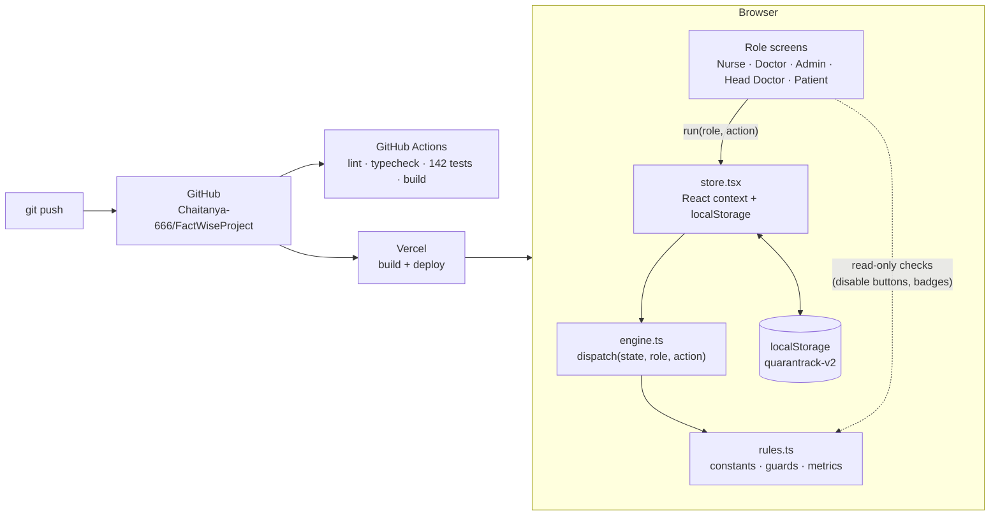
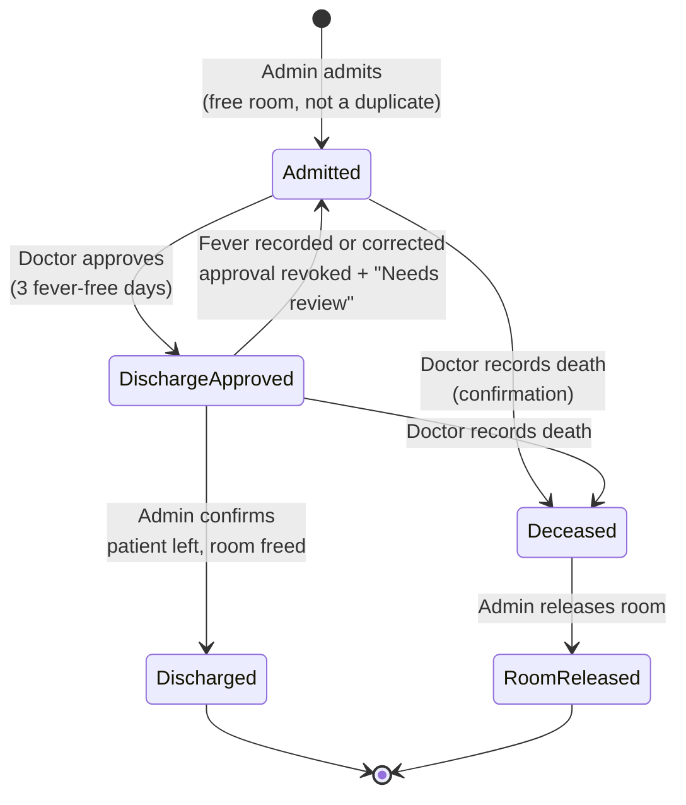
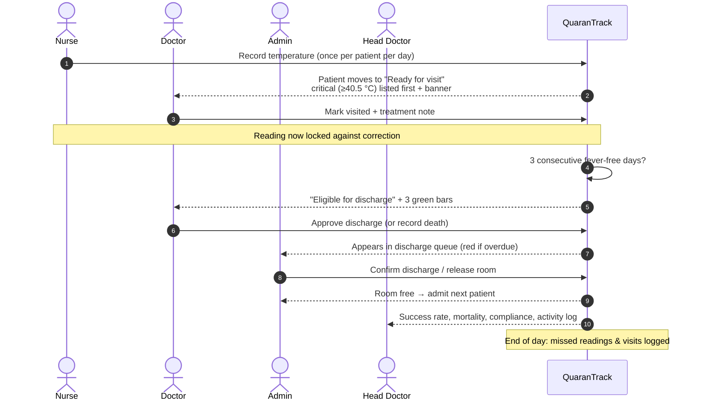
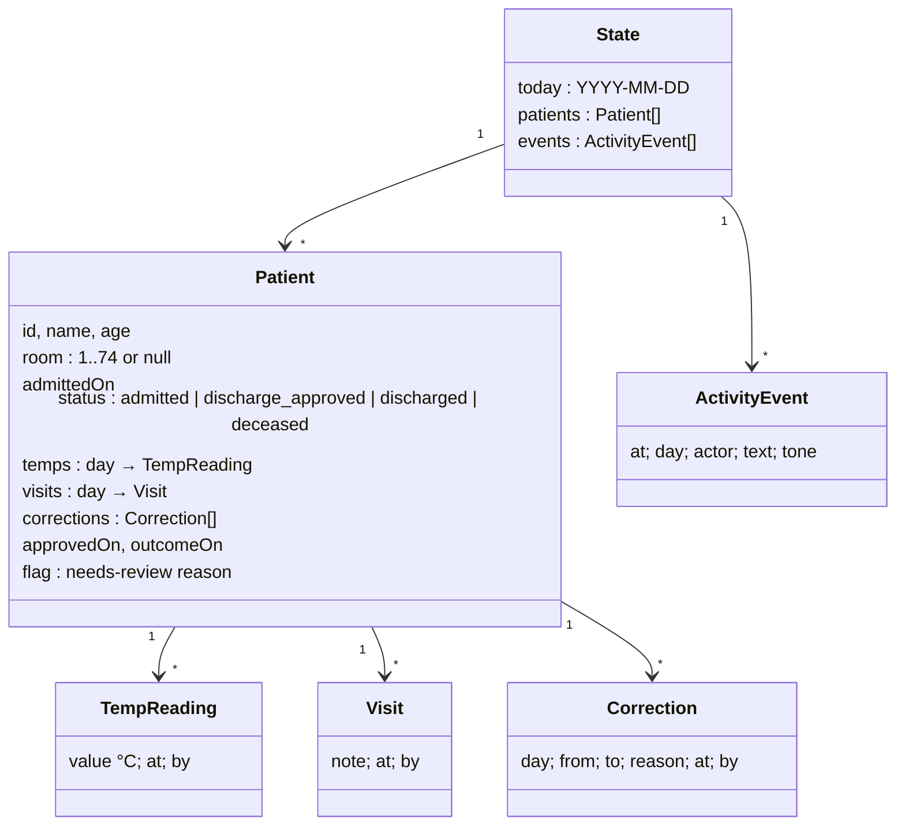
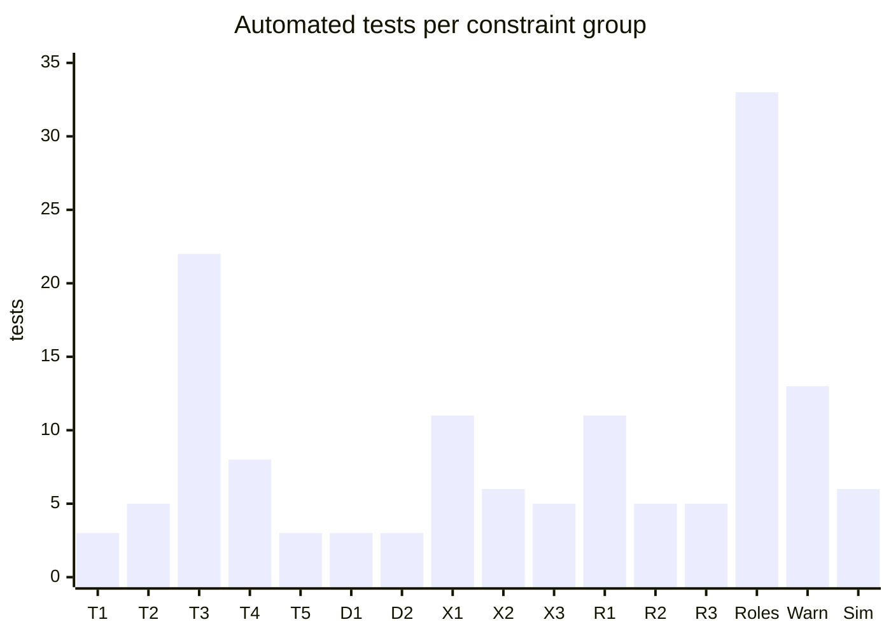
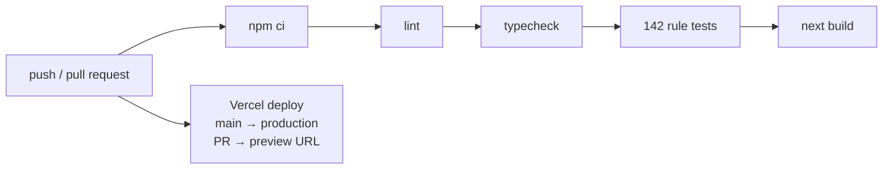

# QuaranTrack — Technical Dossier

Temperature tracking and administration app for a 74-bed virus quarantine & treatment facility.
Prepared by **Chaitanya Shinde** for the FactWise Technical Product Manager assessment (October 2026).

| | |
|---|---|
| Live prototype | https://quarantrack-six.vercel.app |
| Source | https://github.com/Chaitanya-666/FactWiseProject |
| Built with | Claude Code (AI coding agent) · Next.js 15 · React 19 · TypeScript · Tailwind CSS · Recharts |
| Quality gates | 142 automated rule tests · lint · typecheck · production build — on every push (GitHub Actions) |
| Deployment | Vercel, auto-deploy on every push to `main`; preview URL for every pull request |

---

## 1. Problem → solution

The head doctor described five operational failures. Each maps to a specific mechanism in the app:

| Problem from the brief | Mechanism in QuaranTrack | Where |
|---|---|---|
| Nobody knows which patients had their temperature taken; some measured twice, some never | Nurse **Pending / Recorded** lists, "X patients pending today" banner, one reading per patient per day | `/nurse`, `canLogTemp` |
| Nobody knows which patients the doctor visited | Doctor **Ready / Awaiting / Visited** lists, one visit per day | `/doctor`, `canVisit` |
| Doctor visits before the temperature is taken | Visit button disabled with "Temperature not recorded yet" until the reading exists | `canVisit` |
| Patients stay extra days; doctors forget to tell admin | System auto-flags patients meeting the 3-day cure rule; approval lands instantly in the admin queue; overdue approvals turn red; admin can remind doctor | `isEligibleForDischarge`, `/admin` |
| No way to measure performance against the 85% benchmark | Quality dashboard: success & mortality rate with case count, rolling 14-day trend vs 15% line, red alert above benchmark | `/dashboard`, `outcomeStats` |

---

## 2. System architecture



**Design principle — one source of truth for rules.** Every business rule lives in `rules.ts` as a pure function. The UI calls the same functions to decide what to *show* (disabled buttons, warnings), and the engine calls them again to decide what to *allow*. A rule can't be enforced in one place and forgotten in another.

**Why a pure engine.** `dispatch(state, role, action) → { ok, state } | { ok: false, error }` has no React, no storage and no clock dependency, so every rule can be tested directly with plain data. In production this exact function would run on the server behind an API; the UI wouldn't change.

| Layer | File | Lines | Responsibility |
|---|---|---|---|
| Rules | `src/lib/rules.ts` | ~210 | Constants, patient helpers, permission table, action guards, metrics |
| Engine | `src/lib/engine.ts` | ~170 | All state transitions, role check, audit log |
| Store | `src/lib/store.tsx` | ~75 | React state, persistence, `run()` / `reset()` |
| Seed | `src/lib/seed.ts` | ~90 | Deterministic demo data |
| Screens | `src/app/**/page.tsx` | ~510 | Five screens + home |
| Tests | `tests/engine.test.ts` | ~430 | 142 tests |

---

## 3. Patient lifecycle



A room is held from admission until an **admin** confirms the patient physically left (discharge or death). Doctor approval never frees a room by itself.

---

## 4. Daily workflow



---

## 5. Data model



Readings and visits are **keyed by day**, so "one per patient per day" is enforced by the data structure itself as well as by the guard. Nothing is ever deleted: corrections append to `corrections`, outcomes change `status`, and every action writes an `ActivityEvent` (who, when, what).

---

## 6. Constraints handled

All thresholds are single settings in `rules.ts`: `FEVER_C = 38.0`, `CRITICAL_C = 40.5`, `RECHECK_LOW_C = 35`, `RECHECK_HIGH_C = 41`, `MIN_C = 34`, `MAX_C = 43`, `CURE_DAYS = 3`, `CAPACITY = 74`, `BENCHMARK_MORTALITY = 0.15`, `OCCUPANCY_WARN = 0.9`.

### Temperature
| # | Constraint | User sees | Tests |
|---|---|---|---|
| T1 | One reading per patient per day | Input disappears; retry → "Temperature already recorded today." | 3 |
| T2 | Only today, only currently admitted patients | Discharged/deceased → "Patient is not currently admitted." | 5 |
| T3 | Non-numbers and impossible values rejected; 34–35 / 41–43 °C need a re-check | "Enter a number." · "must be between 34 and 43 °C" · "looks unusual — re-check. Save anyway?" | 22 |
| T4 | No deletion; corrections keep old value + mandatory reason; locked after doctor's visit | "Give a reason…" · "Doctor has already reviewed today's reading." · history on patient page | 8 |
| T5 | Fever limit is one setting (38.0 °C, inclusive) | Fever badge, amber value | 3 |

**Temperature input decision table**

| Value | Result |
|---|---|
| not a number, ∞, `"37"` string, null | Rejected |
| < 34.0 or > 43.0 (incl. Fahrenheit like 98.6, 100.4) | Rejected — re-measure |
| 34.0 – 34.9 or 41.1 – 43.0 | Re-check pop-up; saved only after confirmation |
| 35.0 – 37.9 | Saved — normal |
| 38.0 – 40.4 | Saved — fever |
| 40.5 – 41.0 | Saved — critical, doctor alerted, listed first |

### Doctor
| # | Constraint | User sees | Tests |
|---|---|---|---|
| D1 | No visit before today's reading | Button "Temperature not recorded yet" (disabled) | 3 |
| D2 | One visit per patient per day | Moves to "Visited today"; retry refused | 3 |
| D3 | ≥ 40.5 °C is critical | Red banner on doctor screen, patient sorted first | — (UI, manual) |

### Discharge
| # | Constraint | User sees | Tests |
|---|---|---|---|
| X1 | Eligible only after 3 consecutive recorded fever-free days; a missing day breaks the streak | 3 green bars; "Eligible for discharge" tab | 11 |
| X2 | Only a doctor approves; blocked if not eligible | Approve greyed out with "only 2/3 fever-free days" | 6 |
| X3 | Fever (new reading **or** correction) after approval revokes it and flags for review | Red "Needs review" + reason; leaves admin queue | 5 |

**Cure-streak algorithm** (`normalStreak`): start at today if today's reading exists, otherwise yesterday (so a patient doesn't lose their streak just because the nurse hasn't reached them yet); count backwards while a reading exists and is below 38.0 °C. A missing day stops the count — no evidence is not evidence of no fever.

### Rooms
| # | Constraint | User sees | Tests |
|---|---|---|---|
| R1 | Max 74; admission blocked when full; lowest free room auto-assigned | "No rooms available" (disabled) | 11 |
| R2 | Room freed only when admin confirms (discharge or death) | "Confirm discharge" / "Release room" | 5 |
| R3 | Same patient (name ignoring case/spacing + age) can't be admitted twice at once | "… is already admitted in Room X." | 5 |

### Roles
| Action | Nurse | Doctor | Admin | Head Doctor |
|---|:-:|:-:|:-:|:-:|
| Record / correct temperature | ✅ | | | |
| Record visit & notes | | ✅ | | |
| Approve discharge | | ✅ | | |
| Record death | | ✅ | | |
| Admit patient | | | ✅ | |
| Confirm discharge / release room | | | ✅ | |
| Remind doctor | | | ✅ | |
| View dashboard & reports | ✅ | ✅ | ✅ | ✅ |

Enforced inside `dispatch` on every action — a refused action returns an error and never changes state (33 tests: every role × every action).

### Warnings & metrics
| Signal | Rule | Tests |
|---|---|---|
| Nurse pending banner | "X patients pending today" | manual |
| Admin occupancy | green < 67 · amber 67–73 (≥ 90%) · red 74 | 5 |
| Mortality | deaths ÷ (deaths + cured discharges); active patients excluded; shown with "X of Y closed cases" | 7 |
| Benchmark alert | red when mortality > 15% (exactly 15% is on target) | incl. above |
| Day close | "N missed temperature readings, M missed doctor visits" logged | 1 |

---

## 7. Testing

### 7.1 Automated — 142 tests (`tests/engine.test.ts`, Vitest, ~1 s)

Tests are grouped **by the constraint they enforce**, so a failing test names the broken rule.



| Technique | What it covers |
|---|---|
| **Boundary-value tables** (`it.each`) | 22 temperature values around every threshold (33.9 / 34.0 / 34.9 / 35.0 / 37.9 / 38.0 / 40.5 / 41.0 / 41.1 / 43.0 / 43.1, °F values, NaN, ∞, strings, null) |
| **Scenario tables** | 11 cure-streak histories (gaps, fever today, fever at exactly 38.0, 4 normal days, no readings…) |
| **Permission matrix** | all 4 roles × 8 actions, plus "refused action never mutates state" |
| **Randomised simulation** | 5 seeds × 30 simulated days × 150 random actions (right and wrong roles, valid and invalid values). After **every** action, invariants are checked: never > 74 rooms; no two patients share a room; unique IDs; every active patient has a room; discharged patients hold none; no visit without that day's reading; every stored reading within 34–43 °C |
| **End-to-end rule run** | 10 days of normal readings for the full ward → every patient is discharged only after reaching 3/3, and the ward empties |

### 7.2 Manual — 37-step checklist

Covers what unit tests can't: button wiring, confirmation pop-ups, colours/banners, persistence across reload, phone layout. Grouped Nurse (10) · Doctor (7) · Relapse (3) · Admin (8) · Head Doctor (4) · Day cycle & general (7).

### 7.3 CI/CD pipeline



---

## 8. Demo data

`seed.ts` generates the same facility every time (seeded PRNG), so every reviewer sees the same story:

| Cohort | Count | Purpose |
|---|---|---|
| Active patients | 74 (all rooms) | Facility at full occupancy, as in the brief |
| — already approved, waiting on admin | 7 | Admin queue + "overdue" badge |
| — eligible, not yet approved | 19 | Doctor's eligible tab + admin "remind doctor" |
| — one fever-free day short | 14 | Becomes eligible after one more normal reading / End day |
| — still febrile / recovering | 34 | Realistic ward |
| Readings already taken today | 18 | Doctor has a "ready" list immediately |
| Past outcomes (30 days) | 160 (137 cured, 23 deaths → 14.4%) | Dashboard and trend have data on first load |

**End day** advances the simulated date so the 3-day rule can be demonstrated in minutes; **reset** restores the seed.

---

## 9. Decisions & trade-offs

| Decision | Why | Production path |
|---|---|---|
| Browser storage, no backend | Zero infrastructure, no secrets, link can't break during review | Run `dispatch` on the server; Postgres (e.g. Supabase) with one row per reading |
| Role switcher instead of login | Reviewer can walk the whole flow in a minute | Auth with role claims; `dispatch` already takes `role` |
| Pure engine + rules | Every rule testable in isolation; UI and enforcement can't drift | Same code moves server-side unchanged |
| Missing day breaks the cure streak | "3 full days without fever" needs evidence for each day | Configurable if doctors decide otherwise |
| Fever ≥ 38.0 °C, critical ≥ 40.5 °C | Brief didn't define them; standard clinical thresholds; single setting | Admin-editable settings |
| Duplicate check on name + age | No patient ID in the brief | National ID / hospital MRN |

## 10. Known limitations & next sprint

- Data is per browser — two reviewers don't see each other's actions.
- No authentication; any visitor can open any role's screen (the engine still enforces each screen's role).
- Not built (nice-to-have per brief): daily/weekly report export, notifications/reminders at fixed times, Head Doctor undo of a recorded death, offline mode.

---

## 11. Run locally

```bash
npm ci
npm run dev        # http://localhost:3000
npm test           # 142 rule tests
npm run lint && npm run typecheck && npm run build
```
